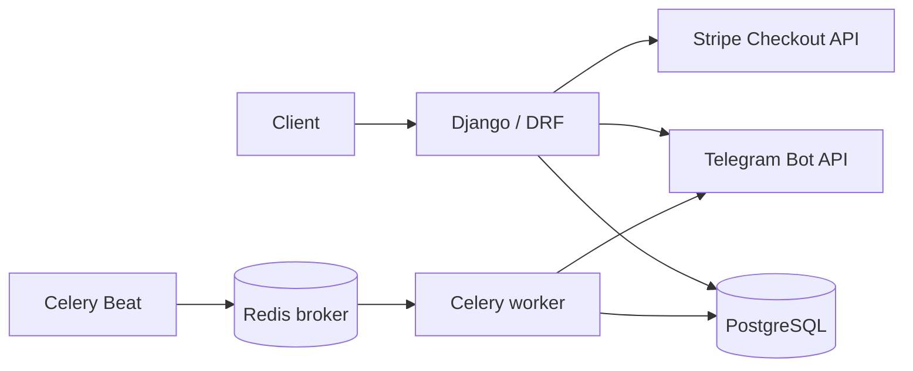

# Library Service API

A REST API for book inventory and the borrowing lifecycle, with email-based JWT authentication, Stripe Checkout payments, late-return fines, Telegram notifications, and scheduled overdue checks. Docker Compose provides a local development environment; this project is not a production deployment configuration.

## Features

- Public book catalogue; staff-only inventory management.
- Borrowing creation and return with transactional inventory updates.
- User-scoped borrowing/payment visibility and staff access across users.
- Stripe Checkout for borrowing charges (`PAYMENT`) and late-return charges (`FINE`).
- Telegram notifications after borrowing creation and during scheduled overdue checks.
- Dynamic OpenAPI schema, Swagger UI, automated tests, and coverage reporting.

## Tech stack

Python 3.13, Django 6.1.2, Django REST Framework 3.18.3, SimpleJWT, PostgreSQL 17 (Compose), SQLite (default local development/tests), psycopg, Stripe, Celery, Redis 7, Telegram Bot API, Docker Compose, drf-spectacular 0.30.0, and coverage.py 7.16.2. Exact dependency pins are in `requirements.txt`.

## Architecture



The web process calls Stripe and Telegram directly. It does not enqueue the overdue task. Beat publishes that task through Redis; the worker reads borrowings and sends notifications. Telegram is an external API, not a separate container or polling bot. Outside Compose, Django defaults to SQLite when `DB_HOST` is absent.

## Local setup

Run these commands in the cloned repository using PowerShell and Python 3.13:

```powershell
python -m venv venv
.\venv\Scripts\Activate.ps1
python -m pip install -r requirements.txt
Copy-Item .env.sample .env
# Edit .env with your integration credentials before exercising those flows.
python manage.py migrate
python manage.py createsuperuser
python manage.py runserver
```

Copy the sample only when creating a new `.env`; preserve an existing file. The API runs at `http://localhost:8000`. A superuser can manage books and use `/admin/`. Registration creates regular users, and the profile endpoint cannot grant staff privileges.

Local Django does not require PostgreSQL or Redis to start. Stripe must be configured to create borrowings or Checkout Sessions. Redis and Celery processes are needed for scheduled notifications; the Compose setup below runs them together.

## Environment variables

Use `.env.sample` as the template. Keep credentials in the untracked `.env`; do not place them in source code or images.

| Variable | Purpose |
| --- | --- |
| `STRIPE_SECRET_KEY` | Stripe **test-mode** secret key for Checkout creation and confirmation. |
| `TELEGRAM_BOT_TOKEN` | Token for the external Telegram Bot API. |
| `TELEGRAM_CHAT_ID` | Destination chat for borrowing and overdue notifications. |
| `CELERY_BROKER_URL` | Local default: `redis://localhost:6379/0`; Compose overrides it with `redis://redis:6379/0`. |
| `POSTGRES_DB` | Required by Compose; sample database name is `library_service`. |
| `POSTGRES_USER` | Required by Compose; sample user is `library_service`. |
| `POSTGRES_PASSWORD` | Set a nonempty local database password before starting Compose. |

Do not add `DB_HOST` to the local `.env` for SQLite development/tests. Compose injects `DB_HOST=db` and `DB_PORT=5432` internally and passes the PostgreSQL credentials to web and worker. The application reads `.env` without overriding existing process variables.

## Docker Compose

Install Docker with Compose and start its engine. Create `.env` from the sample if needed, then set `POSTGRES_DB`, `POSTGRES_USER`, and `POSTGRES_PASSWORD` before running:

```powershell
docker compose up -d --build
```

| Service | Responsibility |
| --- | --- |
| `db` | PostgreSQL 17 with healthcheck and persistent `postgres_data` volume. |
| `redis` | Redis 7 broker with healthcheck; no Compose data volume configured. |
| `web` | Applies migrations, then starts Django's development server on port 8000. |
| `celery` | Executes overdue checks using PostgreSQL and the Redis broker. |
| `celery-beat` | Schedules overdue checks; receives only the broker configuration. |

Web and worker receive integration credentials at runtime. Beat receives no Stripe or Telegram credentials. Only web is published to the host: `http://localhost:8000`; PostgreSQL and Redis use the internal Compose network.

Code comes from the image, without a source bind mount. After code or dependency changes, rerun `docker compose up -d --build`. To create a staff account in this database:

```powershell
docker compose exec web python manage.py createsuperuser
```

Stop the environment with `docker compose down`. The PostgreSQL volume is preserved; `down -v` deletes its data. Starting worker and Beat enables scheduled Telegram notifications when credentials are configured.

## Main API endpoints

| Method | Path | Access / purpose |
| --- | --- | --- |
| GET | `/books/` | Public catalogue. |
| POST | `/books/` | Staff: create a book. |
| GET | `/books/{id}/` | Public book details. |
| PUT / PATCH | `/books/{id}/` | Staff: update a book. |
| DELETE | `/books/{id}/` | Staff: delete; 409 if related borrowings protect it. |
| POST | `/users/` | Public registration with email and password; optional first/last names. |
| POST | `/users/token/` | Public: exchange email/password for access and refresh tokens. |
| POST | `/users/token/refresh/` | Public: exchange a refresh token for an access token. |
| GET / PUT / PATCH | `/users/me/` | Authenticated user's profile. |
| GET / POST | `/borrowings/` | Authenticated: list visible borrowings or create one for yourself. |
| GET | `/borrowings/{id}/` | Authenticated: retrieve a visible borrowing. |
| POST | `/borrowings/{id}/return/` | Authenticated: return a visible borrowing; no request body. |
| GET | `/payments/` | Authenticated: list visible payments. |
| GET | `/payments/{id}/` | Authenticated: retrieve a visible payment. |
| GET | `/payments/success/?session_id=...` | Public Stripe confirmation redirect. |
| GET | `/payments/cancel/` | Public, informational cancellation response. |

Regular users can list/retrieve only their own borrowings and associated payments; staff can access all. Regular users may return their own borrowings, while staff may return any. Inaccessible detail/return records produce 404. Creating a borrowing always uses the current user, including for staff. Borrowing update/delete and payment write endpoints are not exposed.

### Borrowing list filters

Filters apply only to `GET /borrowings/` and can be combined:

| Parameter | Contract |
| --- | --- |
| `is_active` | `true` means not returned; `false` means returned. Case-insensitive. Absent/empty means no status filter. Other nonempty values return 400; whitespace is not trimmed. |
| `user_id` | Staff-only positive integer in the signed 64-bit range (`1` through `9223372036854775807`), using ASCII digits. Leading zeroes are allowed; signs/whitespace are invalid. Absent/empty means no user filter. Invalid nonempty values return 400; an unknown valid ID returns an empty list. Ignored entirely for regular users. |

## Authentication

Obtain tokens with `POST /users/token/` using `email` and `password`. Send the access token in the project's custom header:

```http
Authorize: Bearer <access-token>
```

Use `POST /users/token/refresh/` with `{"refresh": "<refresh-token>"}` to obtain a new access token. Protected endpoints require this custom `Authorize` header. The standard `Authorization` header does not authenticate requests in this project.

## Borrowing lifecycle

Create a borrowing with `book` (book ID) and `expected_return_date` (`YYYY-MM-DD`). The server assigns the user and borrow date. It validates stock, the return date, and a total charge of at least USD 0.50. The price is `(expected_return_date - borrow_date).days * daily_fee`; a same-day borrowing fails the minimum charge validation.

Creation atomically decrements inventory, creates the borrowing, requests a Stripe Checkout Session, and stores a PENDING `PAYMENT`. The response includes its payment details. A Telegram notification runs after the database transaction commits; notification failure is logged without undoing the borrowing.

Return using `POST /borrowings/{id}/return/` with no body. The server sets `actual_return_date`, restores one stock unit, and creates a fine if late. A successful response is the current borrowing representation, including its book and payments. A duplicate return responds with 409. Missing/invalid authentication yields 401; missing or inaccessible borrowings yield 404.

## Payments and Stripe

The API uses Stripe Checkout in USD and stores `session_id`, `session_url`, amount, type, and status. Use the Checkout URL returned in the borrowing/payment representation to pay with Stripe test mode. Checkout redirect URLs are built from the current request host and scheme.

`GET /payments/success/?session_id=...` finds the local payment, then retrieves the Checkout Session from Stripe unless the local payment is already PAID. Only Stripe's `payment_status == 'paid'` changes PENDING to PAID. Other values, including `unpaid` and `no_payment_required`, leave it PENDING. A completed Session alone or a client-supplied payment status does not confirm payment.

The public response contains only `detail` and `status` (PAID or PENDING), with HTTP 200 in either case. A missing/blank `session_id` returns 400; surrounding whitespace is trimmed. An unknown local session returns 404. Already-paid requests return confirmation without another Stripe lookup.

`GET /payments/cancel/` requires no input and returns only `detail` with HTTP 200. It does not change the database or Stripe; the existing Checkout link remains usable while its Session is active.

There is no Stripe webhook or automatic Session renewal. Confirmation depends on the success endpoint. Database transactions roll back on Checkout failures, but an external Session already created before a later database failure is not automatically cancelled.

## Late-return fines

A late return creates a separate PENDING `FINE`, preserving the original borrowing payment:

```text
days_overdue = max((actual_return_date - expected_return_date).days, 0)
fine = days_overdue * daily_fee * FINE_MULTIPLIER
FINE_MULTIPLIER = 2
```

A fine of at least USD 0.50 receives a Stripe Checkout Session. A smaller fine remains a local PENDING FINE with empty Session fields; there is no automatic retry or alternative settlement endpoint. Returning on or before the expected date creates no fine. The same success endpoint confirms both PAYMENT and FINE Sessions.

## Telegram notifications

Configure `TELEGRAM_BOT_TOKEN` and `TELEGRAM_CHAT_ID` to receive borrowing-creation notifications and scheduled overdue notifications. The web process sends creation notifications after commit; the Celery worker sends overdue notifications. Transport/configuration failures are logged. There is no Telegram service container or bot polling process.

## Celery and scheduled overdue checks

Redis is the broker, the worker executes `borrowings.tasks.check_overdue_borrowings`, and Beat schedules it daily at **00:00 in `America/Sao_Paulo`**. Django's application timezone is UTC; date comparisons use `timezone.localdate()`.

The task selects unreturned borrowings with `expected_return_date <= today`, so its notification selection includes books due today. This is distinct from the fine calculation, which requires a return strictly after the expected date. It sends one notification per selected borrowing, or a no-overdue message when none qualify. Unreturned records remain eligible on subsequent runs. The task does not create fines.

Compose starts both Celery processes. In a separate local environment with a reachable Redis broker, their commands are:

```text
celery -A config worker --loglevel=info
celery -A config beat --loglevel=info
```

## Tests

With the virtual environment activated and `DB_HOST` absent, tests use Django's isolated SQLite test database:

```powershell
python manage.py test
python manage.py test config borrowings payments
python manage.py check
python -m pip check
python manage.py makemigrations --check
```

Integration tests mock Stripe/Telegram. Do not create a real borrowing or manually dispatch the overdue task just to verify documentation.

## Coverage

[coverage.py](https://coverage.readthedocs.io/en/latest/config.html) uses `.coveragerc` to measure all application packages, excluding tests, migrations and bootstrap scripts. No minimum threshold is enforced.

```powershell
coverage erase
coverage run manage.py test
coverage report -m
# Optional HTML report:
coverage html
```

Open `htmlcov/index.html` for the HTML report. `.coverage` and `htmlcov/` are ignored by Git and the Docker build.

## Swagger / OpenAPI

- Swagger UI: http://localhost:8000/api/docs/
- OpenAPI schema: http://localhost:8000/api/schema/

Both documentation endpoints are public. The schema is generated dynamically using [drf-spectacular](https://drf-spectacular.readthedocs.io/en/latest/customization.html), including borrowing filters/return and payment redirect contracts. Swagger UI loads its assets from a CDN, requiring browser internet access.

In Swagger's **Authorize** dialog, enter the full value `Bearer <access-token>` into the API-key-style field. The resulting header is `Authorize`. Payment success/cancel and catalogue reads do not require JWT.

Validate the schema without keeping a generated artifact in the repository:

```powershell
python manage.py spectacular --validate --fail-on-warn --file "$env:TEMP/library-service-openapi.yaml"
```
